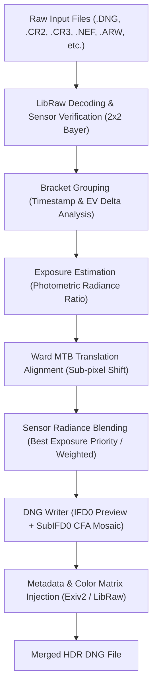

# HDR DNG Merger (v1.0)

[](https://github.com/rolanddd-hu/HDR_DNG_Merger)
[](LICENSE)
[]()
[]()

A high-performance, raw-to-raw HDR merging application and command-line utility for bracketed exposures. Merges multiple raw photographs (drones, mirrorless, DSLRs, and medium-format cameras) into single, high-dynamic-range **DNG** raw files before demosaicing, preserving full sensor dynamic range, original colour matrices, and EXIF/GPS metadata.

Compatible with major raw processors including **Adobe Lightroom Classic**, **Adobe Camera Raw**, **Capture One Pro**, **Darktable**, **RawTherapee**, and **Affinity Photo**.

---

## Table of Contents

- [Key Features](#key-features)
- [Supported Raw Formats](#supported-raw-formats)
- [Architecture & Pipeline](#architecture--pipeline)
- [Graphical User Interface (GUI)](#graphical-user-interface-gui)
  - [Bracket List & Organization](#bracket-list--organization)
  - [Interactive Preview Canvas](#interactive-preview-canvas)
  - [Tone Adjustments & Presets](#tone-adjustments--presets)
  - [Merge Settings](#merge-settings)
  - [Batch Queue & Logging](#batch-queue--logging)
- [Command Line Interface (CLI)](#command-line-interface-cli)
  - [Command Reference](#command-reference)
  - [Batch Processing Examples](#batch-processing-examples)
  - [Metadata Inspection & Debugging](#metadata-inspection--debugging)
  - [Synthetic HDR Demo Generator](#synthetic-hdr-demo-generator)
- [DNG Output & Software Compatibility](#dng-output--software-compatibility)
- [Building from Source](#building-from-source)
- [Keyboard Shortcuts](#keyboard-shortcuts)
- [License](#license)

---

## Key Features

- **True RAW-to-RAW Blending**: Merges raw CFA Bayer mosaic data directly without intermediate demosaicing or destructive gamma conversion.
- **Ward MTB Alignment**: Translation alignment using multi-scale Median Threshold Bitmaps (MTB) on log luminance to remove handheld and drone drift. Shifts are whole 2×2 Bayer quads (2-pixel steps) so the mosaic stays intact; there is no sub-pixel refinement. The output crop is reduced to the area every frame covers.
- **Capture One & Lightroom Compatibility**: Generates standard uncompressed 16-bit integer CFA DNGs (required by Capture One) or 16/24/32-bit floating-point DNGs with lossless Deflate + floating-point predictor compression.
- **Full Metadata & GPS Preservation**: Copies camera model, lens parameters, capture time, exposure details, and GPS coordinates into the destination DNG using Exiv2 (including Canon CR3 ISOBMFF support).
- **GPU-Accelerated Real-Time Preview**: Fast OpenGL GLSL shaders provide live exposure adjustment, filmic tone curves, clipping overlays, and real-time histogram calculation.
- **Batch Processing**: Automatically groups imported photos into brackets based on timestamps, time spans, and EV spreads with customizable naming patterns. Several brackets can merge in parallel; a memory budget keeps concurrent jobs within available RAM.
- **Safe Output**: Merges are written to a temporary file and only moved into place once complete, so a failed or cancelled job never leaves a broken DNG. A merge refuses to overwrite its own source files, file names are sanitised, and batch names never collide (`_2`, `_3`, ... are appended).
- **Unicode Paths**: Folders and file names with accented or non-Latin characters work everywhere (UTF-8 process code page, wide-character file APIs).
- **Multithreaded C++20 Core**: Decoding, alignment, merging and DNG encoding use all CPU cores. The core library is portable; the GUI and CLI are currently built and tested on Windows only.

---

## Supported Raw Formats

The application decodes raw sensor data via LibRaw and supports standard 2×2 RGB Bayer sensors across all major manufacturers:

| Manufacturer | Extensions | Status | Notes |
|---|---|---|---|
| **Adobe / Generic DNG** | `.dng` | ✅ Full | DJI drones, smartphones, cameras, converted DNGs |
| **Canon** | `.cr2`, `.cr3` | ✅ Full | CR3 includes C-RAW (lossy compressed) and BMFF metadata |
| **Nikon** | `.nef`, `.nrw` | ✅ Full | Lossless/Compressed NEF. *(Nikon HE/HE\* high-efficiency formats require standard lossless setting)* |
| **Sony** | `.arw`, `.srf`, `.sr2` | ✅ Full | ARW 1.0–4.0 uncompressed and compressed |
| **Panasonic** | `.rw2` | ✅ Full | Lumix G and S series cameras |
| **Olympus / OM System** | `.orf` | ✅ Full | OM-D, PEN, OM System |
| **Fujifilm** | `.raf` | ✅ Bayer only | GFX medium format and Bayer X-series (X-A, X-T200). *(X-Trans 6×6 sensors are detected and flagged)* |
| **Pentax / Ricoh** | `.pef`, `.raw` | ✅ Full | K-series and Ricoh GR |
| **Hasselblad** | `.3fr`, `.fff` | ✅ Full | Medium format single-shot captures |
| **Phase One** | `.iiq` | ✅ Full | Digital backs and medium-format systems |

> **Note on Reduced-Size RAWs**: Canon sRAW/mRAW and Nikon Small/Medium NEF are pre-demosaiced formats that do not contain raw Bayer mosaic data and cannot be merged. Use full-resolution raw settings on the camera.

---

## Architecture & Pipeline



1. **Decoding & Validation**: Files are inspected for Bayer pattern compatibility, black/white levels, active crop areas, and camera white balance multipliers.
2. **Grouping**: Files are grouped into brackets by count (e.g. 3-shot or 5-shot) or automatically by timestamp proximity.
3. **Relative Exposure Estimation**: The exposure ratio between frames is calculated from shutter speed, ISO, and aperture metadata, calibrated against linear pixel radiance.
4. **Alignment**: Handheld or drone drift is registered using Ward's multi-resolution Median Threshold Bitmap algorithm (whole-quad shifts). Relative exposures are then refined on the aligned frames.
5. **Merging**: Either *Best Exposure* (per region the brightest unclipped frame, feathered) or *Weighted Average* (all unclipped frames, weighted by exposure and a hat function). Saturation thresholding (`clipThreshold`, default 0.92) and optional motion deghosting decide which frames may contribute.
6. **DNG Writing**: Produces an IFD0 directory containing an 8-bit debayered sRGB thumbnail preview, followed by a SubIFD containing the raw merged Bayer mosaic.
7. **Metadata Transplant**: Standard EXIF, GPS, and custom XMP tags are written to the target file.

---

## Graphical User Interface (GUI)

Launch the desktop application with:

```bash
hdrmerge_gui
```

### Bracket List & Organization
- **Auto-Grouping**: Scans folders and groups files into $N$-frame brackets or automatically detects bracket sizes using timestamp clustering.
- **Card View with Thumbnails**: Displays groups and individual frames as unified cards. Includes interactive thumbnails configurable in three sizes:
  - **Small**: 48 × 30 px (compact list view)
  - **Medium**: 240 × 150 px (balanced preview)
  - **Large**: 480 × 300 px (detailed inspection)
- **Status Warnings**: Visual indicators flag bracket errors such as camera/dimension mismatch, excessive time span between shots, or low exposure variation ($< 0.5$ EV).
- **Context Menus**: Right-click any bracket or frame to:
  - Set a custom reference frame for alignment and metadata.
  - Exclude/include specific frames from the merge.
  - Split a bracket group at a chosen frame.
  - Merge a single bracket immediately without waiting for a batch.

### Interactive Preview Canvas
- **Pan & Zoom**: Smooth mouse drag navigation with mouse-wheel zoom up to 20× magnification (mipmapped, so zoomed-out views do not shimmer). Press <kbd>F</kbd> or toggle **Fit to Window** to re-center.
- **Split Before / After View**: Compares the tone-adjusted HDR preview against a neutral reference frame side-by-side or using an interactive slider.
- **Exposure Clipping Overlay**: Highlights under-exposed shadow pixels in blue and saturated/blown highlight pixels in red.
- **Motion & Source Maps**: Visualize deghosting motion masks and color-coded contributions showing which exposure frame contributes to each region.
- **Real-Time Pixel Inspector**: Hover over any pixel to view its sensor coordinates and linear RGB radiance.

### Tone Adjustments & Presets
Includes 15 built-in tone curves tailored for landscape, architectural, and high-contrast photography:

- **Presets**: *Default*, *Max Dynamic Range*, *Shadow Reveal*, *Deep Shadow Boost*, *Highlight Recovery*, *Extreme Highlights*, *Landscape HDR*, *Sunset & Golden Hour*, *Architecture Crisp*, *Vivid Nature*, *Dramatic*, *Soft Matte*, *Black & White HDR*, *Reinhard Smooth*, *Linear RAW*.
- **Tone Mapping Operators**:
  - `Filmic (ACES)`: Krzysztof Narkowicz ACES S-curve with natural highlight roll-off.
  - `AgX`: Modern Blender 4+ tone mapping that prevents hue shifts in saturated highlights.
  - `Reinhard (Classic)`: Traditional asymptotic compression $x / (1 + x)$.
  - `Reinhard (Luma)`: Preserves original saturation while mapping luminance.
  - `Hable / Uncharted 2`: Filmic curve with distinct shoulder, linear midtones, and toe.
  - `Lottes (AMD)`: Sigmoidal compression with crisp contrast.
  - `Uchimura (Gran Turismo)`: Emulates physical camera and film response.
  - `None (Linear)`: Pure unmapped linear radiance clamped to 1.0.
- **Fine-Tuning Sliders**: Exposure ($\pm 5$ EV), Highlights, Shadows, Whites, Blacks, Contrast, Vibrance, Saturation, Temperature, and Tint ($\pm 100$).
- **Live Histogram**: RGB and luminance histogram of exactly what the preview shows (read back from the GPU tone pipeline), drawn with ImPlot.
- **Lightroom Export**: With *Write Lightroom XMP settings* enabled, Exposure, Contrast, Highlights, Shadows, Whites, Blacks, Vibrance and Saturation are stored as Lightroom/ACR develop settings (`crs:*`) in the merged DNG. Temperature/Tint and the preview tone-map operator have no Lightroom equivalent and are not exported.

### Merge Settings
- **Bit Depth Selection**:
  - **Auto / 16-bit Int** *(Default)*: Uncompressed 16-bit integer CFA strips. Required for **Capture One** compatibility.
  - **16-bit Float (F16)**: Half-precision floating-point DNG.
  - **24-bit Float (F24)**: Adobe 24-bit floating-point format.
  - **32-bit Float (F32)**: Full single-precision IEEE 754 floating-point raw.
  - Float output is always losslessly compressed (Deflate + floating-point predictor): LibRaw-based converters such as darktable and RawTherapee cannot read uncompressed float DNGs.
  - 16-bit integer output stores the merged range linearly. For very wide brackets (sensor bits + bracket EV > 16) the deepest shadows lose some precision; the log warns when that happens. Prefer 32-bit float if your raw converter supports it.
- **Merge Mode**: *Best Exposure* (default) or *Weighted Average*.
- **Alignment**: Ward MTB translation alignment in 2-pixel steps with configurable search radius (up to 256 px).
- **Motion Deghosting**: Off / Low / Medium / High. Moving regions are taken from the reference frame only.
- **Embedded Preview**: Full-size (long side 1920 px) or a small 256 px thumbnail.
- **Naming Patterns**: Formats output filenames using customizable tokens (e.g. `{first}_HDR`, `{camera}_{date}_{index}`).

### Batch Queue & Logging
- **Batch Processing**: Run all pending brackets in a background thread pool with live progress bars. *Parallel Jobs* sets how many brackets merge at once (0 = auto); merging a single bracket from the context menu adds it to the running queue.
- **Log Panel**: Real-time, filterable spdlog message feed. The log is also written to `%APPDATA%\HDR_DNG_Merger\logs\hdrmerge.log`.

---

## Command Line Interface (CLI)

The CLI tool `hdrmerge_cli` enables headless automation, batch scripting, and metadata analysis.

```
HDR DNG Merger CLI
Usage: hdrmerge_cli.exe [OPTIONS]

Options:
  -h,--help                   Print this help message and exit
  --info TEXT                 Dump metadata for a raw DNG or camera raw file
  --dump TEXT                 Dump TIFF directory tags for any DNG file
  -i,--input TEXT ...         Input file(s) or directories to scan
  -n,--frames INT             Frames per bracket (default: 3)
  -o,--output TEXT            Output directory for merged DNG files (default: HDR_Output)
  --bits INT                  Output bit depth: 0 (Auto/Int16), 1 (Int16), 16 (F16), 24 (F24), 32 (F32)
  --skip-existing             Skip merge if output file already exists
  --pattern TEXT              Output naming pattern (default: {first}_HDR)
  --deghost INT               Deghosting sensitivity: 0 (Off), 1 (Low), 2 (Medium), 3 (High)
  --weighted                  Weighted-average merge instead of best-exposure selection
  --no-align                  Disable Ward MTB translation alignment
  -j,--jobs INT               Brackets merged in parallel (0 = auto; memory use is capped)
  --demo [TEXT]               Generate extreme 6-stop HDR demo bracket and merged DNG
```

Exit codes: `0` success, `1` invalid arguments or no input, `2` at least one bracket failed, `130` cancelled with <kbd>Ctrl</kbd>+<kbd>C</kbd> (no partial files are left behind).

### Batch Processing Examples

Merge an entire directory of drone shots in brackets of 3:
```bash
hdrmerge_cli -i "D:\Photos\Drone" -n 3 -o "D:\Photos\Drone\Merged"
```

Merge specific files into 16-bit integer DNGs for Capture One:
```bash
hdrmerge_cli -i frame1.DNG frame2.DNG frame3.DNG --bits 1 -o ./Output
```

Merge with custom naming pattern and skip existing files:
```bash
hdrmerge_cli -i ./RawFolder -n 5 --pattern "{camera}_{date}_Bracket_{index}" --skip-existing -o ./HDR_Output
```

#### Available Pattern Tokens

| Token | Description | Example |
|---|---|---|
| `{first}` | Stem of the first frame | `DJI_0101` |
| `{last}` | Stem of the last frame | `DJI_0103` |
| `{ref}` | Stem of the reference exposure frame | `DJI_0102` |
| `{index}` | Sequential bracket index (1-based) | `1`, `2`, `3` |
| `{n}` | Number of active frames in bracket | `3`, `5` |
| `{iso}` | ISO rating of reference frame | `100`, `400` |
| `{shutter}` | Safe filename shutter speed | `1_250s`, `2s` |
| `{fnumber}` | Aperture of reference frame | `f2_8`, `f8` |
| `{camera}` | Camera model name | `FC3582`, `EOS_77D` |
| `{date}` | Capture date (`YYYYMMDD`) | `20261014` |

### Metadata Inspection & Debugging

Inspect raw metadata, CFA pattern, black/white levels, and color matrices:
```bash
hdrmerge_cli --info "photos/DJI_0304.DNG"
```

*Output example:*
```
========================================
RAW / DNG INFO: DJI_0304.DNG
========================================
Camera:         Hasselblad L2D-20c
Visible Size:   5280 x 3956
Shutter:        0.002 s (1/500s)
Aperture:       f/2.8
ISO:            100
Rel. Exposure:  0.0255
Date/Time:      2026:10:14 12:30:15
CFA Pattern:    RGGB
Black Levels:   [144, 144, 144, 144]
White Level:    4095
Baseline Exp:   0 EV
AsShotNeutral:  [0.488, 1.000, 0.547]
WB Multipliers: [2.049, 1.000, 1.828]
========================================
```

Dump all TIFF SubIFDs, sample formats, and DNG opcodes:
```bash
hdrmerge_cli --dump "output.dng"
```

### Synthetic HDR Demo Generator

Generate a synthetic, extreme 6-stop bracket ($-3$ EV, $0$ EV, $+3$ EV) and merged output to verify highlight recovery and color fidelity in your raw processor:

```bash
hdrmerge_cli --demo "photos/demo_hdr"
```

---

## DNG Output & Software Compatibility

| Raw Developer | Recommended Bit Depth | Compatibility Notes |
|---|---|---|
| **Capture One Pro** | `Auto` or `16-bit Int` (`--bits 1`) | **Crucial:** Capture One does not open floating-point CFA DNGs. It requires single-strip, uncompressed 16-bit integer CFA DNGs. |
| **Adobe Lightroom Classic** | Any (`Auto`, `F16`, `F24`, `F32`) | Fully supports floating-point DNGs. Baseline exposure and color matrices allow $+5$ EV highlight recovery. |
| **Adobe Camera Raw (ACR)** | Any (`Auto`, `F16`, `F24`, `F32`) | Identical support to Lightroom Classic. |
| **Darktable** | Any (`Auto`, `F16`, `F32`) | Supports integer and float DNG mosaics. |
| **RawTherapee** | Any (`Auto`, `F16`, `F32`) | Reads CFA mosaic directly with full dynamic range. |
| **Affinity Photo 2** | `Auto` or `16-bit Int` | Opens merged DNGs in Develop Persona. |

---

## Building from Source

### Prerequisites
- **C++20 Compiler**: Visual Studio 2022 (MSVC 19.34+), GCC 11+, or Clang 13+
- **CMake**: Version 3.25 or higher
- **vcpkg**: Microsoft C++ Package Manager

### Windows (Visual Studio 2022 + vcpkg)

1. Clone the repository:
   ```cmd
   git clone https://github.com/rolanddd-hu/HDR_DNG_Merger.git
   cd HDR_DNG_Merger
   ```

2. Configure with CMake using `vcpkg` manifest mode:
   ```cmd
   cmake -B build -S . -DCMAKE_TOOLCHAIN_FILE="C:/path/to/vcpkg/scripts/buildsystems/vcpkg.cmake"
   ```

3. Build the Release configuration:
   ```cmd
   cmake --build build --config Release
   ```

4. Executables will be generated in `build/bin/Release/`:
   - `hdrmerge_gui.exe` (Desktop GUI)
   - `hdrmerge_cli.exe` (Command-Line Utility)
   - `hdrcore_tests.exe` (Test Suite)

### Linux (Ubuntu 22.04+, untested)

The core library is portable, but the GUI and CLI have only been built and tested on Windows.

1. Install system prerequisites:
   ```bash
   sudo apt update
   sudo apt install -y build-essential cmake ninja-build libgl1-mesa-dev libxrandr-dev libxinerama-dev libxcursor-dev libxi-dev
   ```

2. Configure and build:
   ```bash
   cmake -B build -S . -DCMAKE_BUILD_TYPE=Release -DCMAKE_TOOLCHAIN_FILE="$VCPKG_ROOT/scripts/buildsystems/vcpkg.cmake"
   cmake --build build -j$(nproc)
   ```

### Build Options

| Option | Default | Purpose |
|---|---|---|
| `HDR_BUILD_GUI` / `HDR_BUILD_CLI` / `HDR_BUILD_TESTS` | `ON` | Select targets (only the matching vcpkg dependencies are installed) |
| `HDR_WARNINGS_AS_ERRORS` | `OFF` | `/WX` (used by CI) |
| `HDR_ENABLE_ASAN` | `OFF` | AddressSanitizer build for testing |

### Running the Test Suite

Verify all mathematical, alignment, merging, round-trip DNG serialization, metadata and safety tests:
```bash
ctest --test-dir build -C Release -j 8
```

GitHub Actions builds and tests every push and pull request (`.github/workflows/build.yml`).

---

## Keyboard Shortcuts

| Shortcut | Context | Action |
|---|---|---|
| <kbd>↑</kbd> / <kbd>↓</kbd> | Bracket List | Select previous / next bracket group or frame |
| <kbd>Enter</kbd> | Bracket List | Expand or collapse selected bracket group |
| <kbd>→</kbd> | Bracket List | Expand selected bracket group |
| <kbd>←</kbd> | Bracket List | Collapse selected bracket group |
| <kbd>Double Click</kbd> | Bracket List | Expand or collapse bracket group |
| <kbd>F</kbd> | Preview | **Fit to Window** zoom |
| <kbd>1</kbd> | Preview | 100% (1:1) zoom |
| <kbd>C</kbd> | Preview | Toggle **Clipping Warnings** overlay |
| <kbd>B</kbd> | Preview | Toggle **Before / After** split-screen comparison |
| <kbd>M</kbd> | Preview | Toggle the motion (deghosting) mask overlay |
| <kbd>S</kbd> | Preview | Toggle the source-frame map overlay |
| <kbd>Double Click</kbd> | Tone Panel | Reset a slider to its default |
| <kbd>Mouse Drag</kbd> | Preview | Pan around image canvas |
| <kbd>Scroll Wheel</kbd> | Preview | Zoom in / out centered at cursor position |
| <kbd>Right Click</kbd> | Bracket List | Open contextual actions menu |

---

## License

This project is licensed under the **GNU General Public License v3.0 or later** (GPL-3.0-or-later). See `LICENSE` for details.
